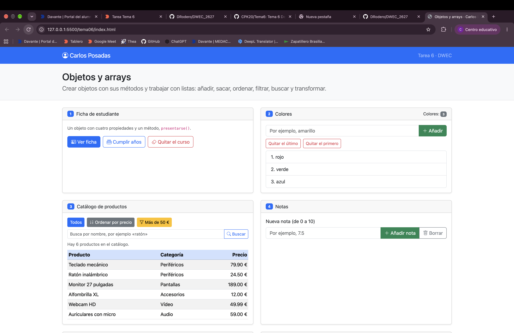
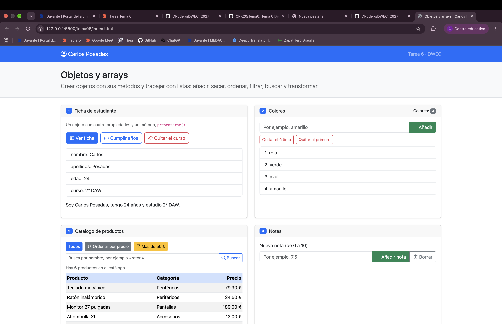
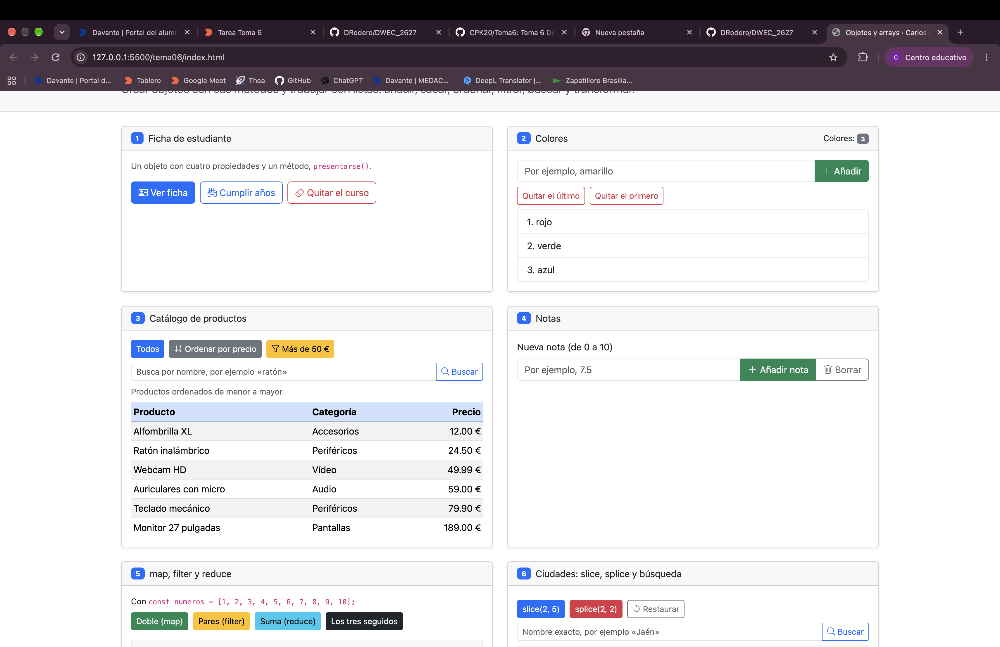
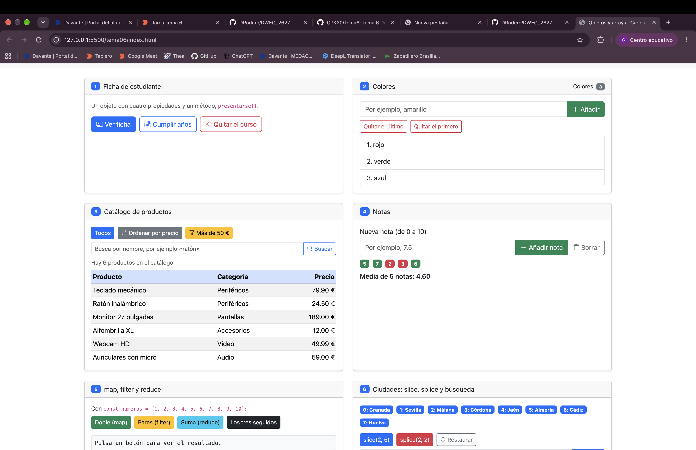
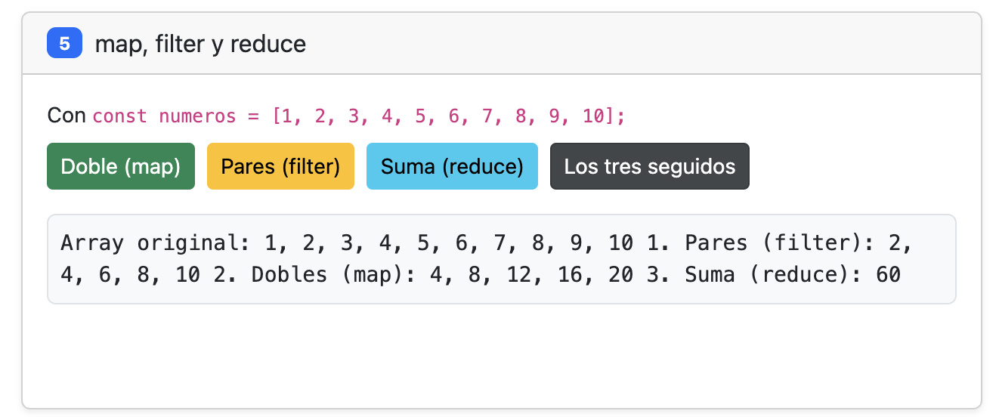
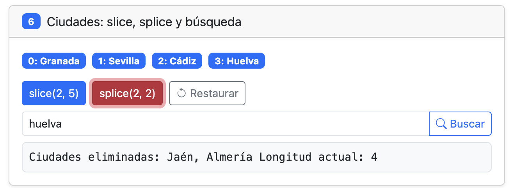

# Tarea 6 · Objetos y arrays

**Autor:** [Tu nombre y apellidos] · Desarrollo Web en Entorno Cliente (DWEC) · 2.º DAW · Curso 2026-27

> **Plantilla de la tarea 6.** Cómo usarla:
>
> 1. Copia esta carpeta en tu repositorio de DWEC y cámbiale el nombre a `tema06`.
> 2. `index.html` ya está maquetado: seis tarjetas, una por ejercicio. No cambies los `id` ni el `onclick` de los botones.
> 3. `js/app.js` trae una función por botón con `TODO`. Ya están hechas `comoTexto()`, `pintarProductos()` y casi todo el ejercicio 2: úsalas de modelo.
> 4. Todas las funciones con `function`: en esta tarea, sin funciones flecha.
> 5. Sustituye las imágenes de `capturas/` por las tuyas, **con el mismo nombre**.
> 6. Todo lo que va entre [corchetes] es un hueco: cámbialo por lo tuyo. Al terminar, borra este aviso.

[Una o dos líneas: qué hay en esta carpeta y cómo se ve. Por ejemplo: abrir la carpeta en VS Code, pulsar **Go Live** y probar los botones con la consola abierta (F12).]

## Capturas

### a) La página recién cargada

Se crea un objeto estudiante con los datos del alumno.

Se utilizan propiedades, métodos y this para mostrar la ficha, aumentar la edad y eliminar la propiedad del curso.

También se utiliza delete para borrar una propiedad del objeto.

### b) Ejercicios 1 y 2: la ficha y los colores

Se trabaja con un array de colores que puede modificarse mediante distintos botones.

Se utilizan los métodos push(), pop() y shift() para añadir colores y eliminar elementos del principio o del final del array.

### c) Ejercicio 3: el catálogo ordenado por precio

Se trabaja con un array de objetos que representan productos con su nombre y precio.

Se utilizan los siguientes métodos:

sort() para ordenar los productos por precio.

filter() para mostrar los productos que cuestan más de 50.

find() para buscar un producto por su nombre.

Para mostrar los productos se crean elementos HTML mediante JavaScript.

### d) Ejercicio 4: las notas y la media

Se crea un objeto alumno que almacena las notas en un array.

El usuario puede introducir notas entre 0 y 10, visualizar las notas aprobadas en verde y las suspensas en rojo, calcular la media y borrar todas las notas.

Se utilizan push(), reduce(), Number.isNaN() y toFixed(2).

### e) Ejercicio 5: los tres métodos seguidos

Se utiliza un array con los números del 1 al 10 para practicar tres métodos de JavaScript:

map() para obtener el doble de cada número.

filter() para seleccionar los números pares.

reduce() para sumar todos los elementos.

También se combinan los tres métodos para seleccionar los pares, multiplicarlos por dos y sumarlos, obteniendo como resultado 60.

### f) Ejercicio 6: después de splice y de buscar una ciudad

Se trabaja con un array de ciudades españolas.

Se utilizan los métodos:

slice() para obtener una parte del array sin modificarlo.

splice() para eliminar elementos del array original.

includes() para comprobar si existe una ciudad.

indexOf() para obtener la posición de una ciudad.

El operador de expansión (...) para restaurar el array original.

## Reflexión

## Fuentes

- [Título de la página](https://enlace-a-la-fuente)

## Uso de IA

